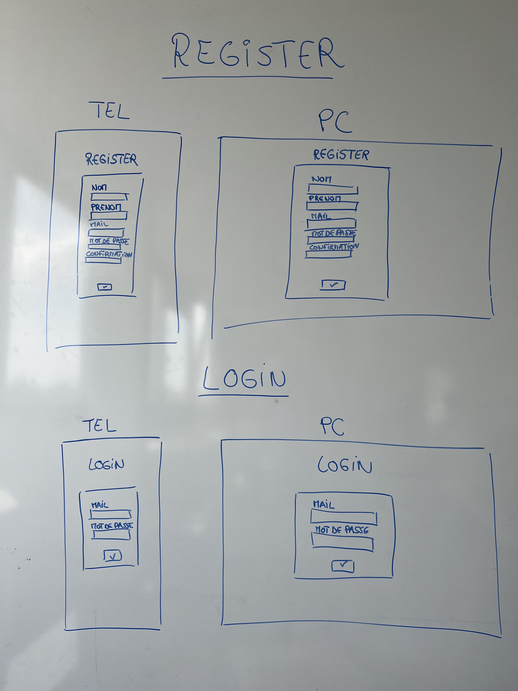
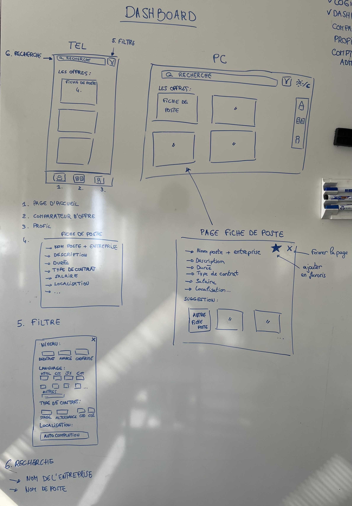
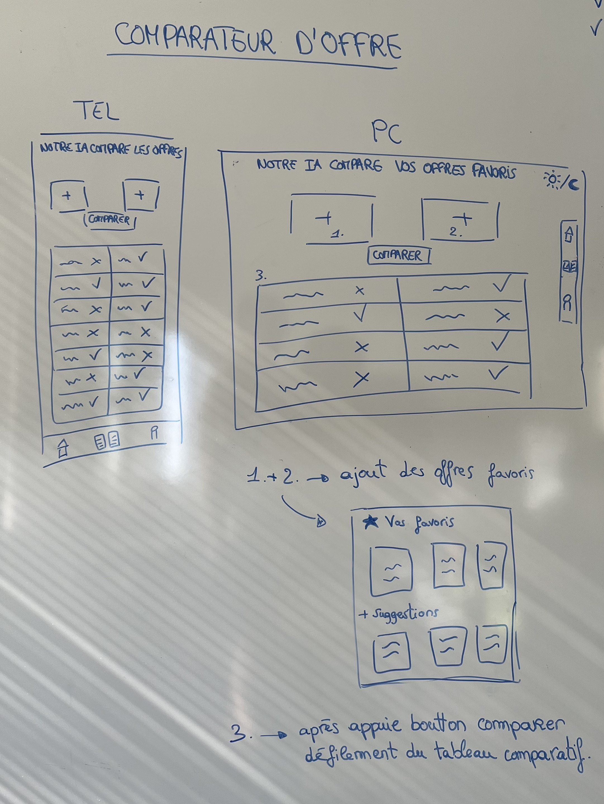
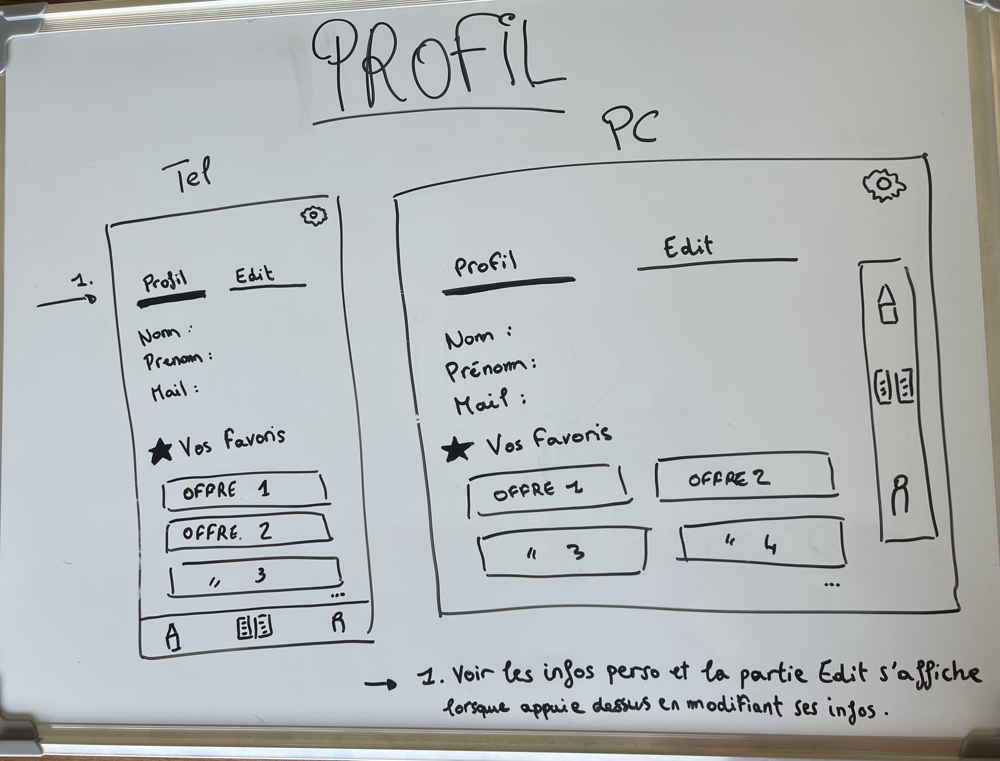
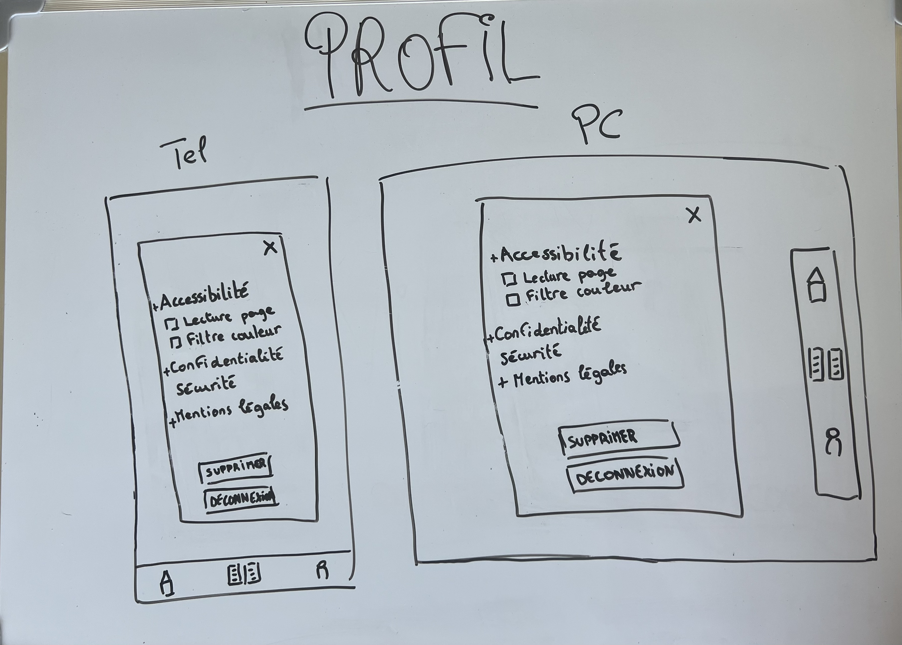
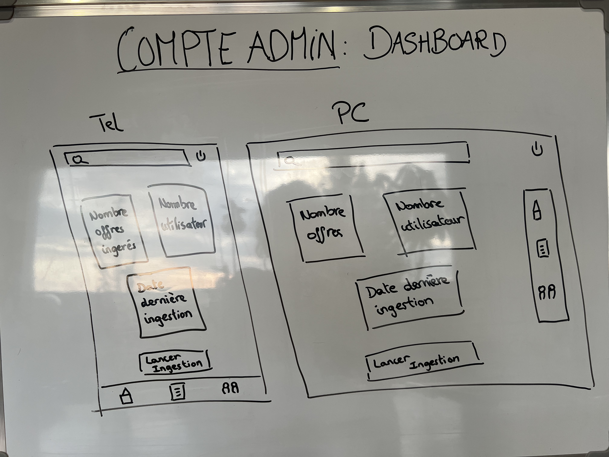
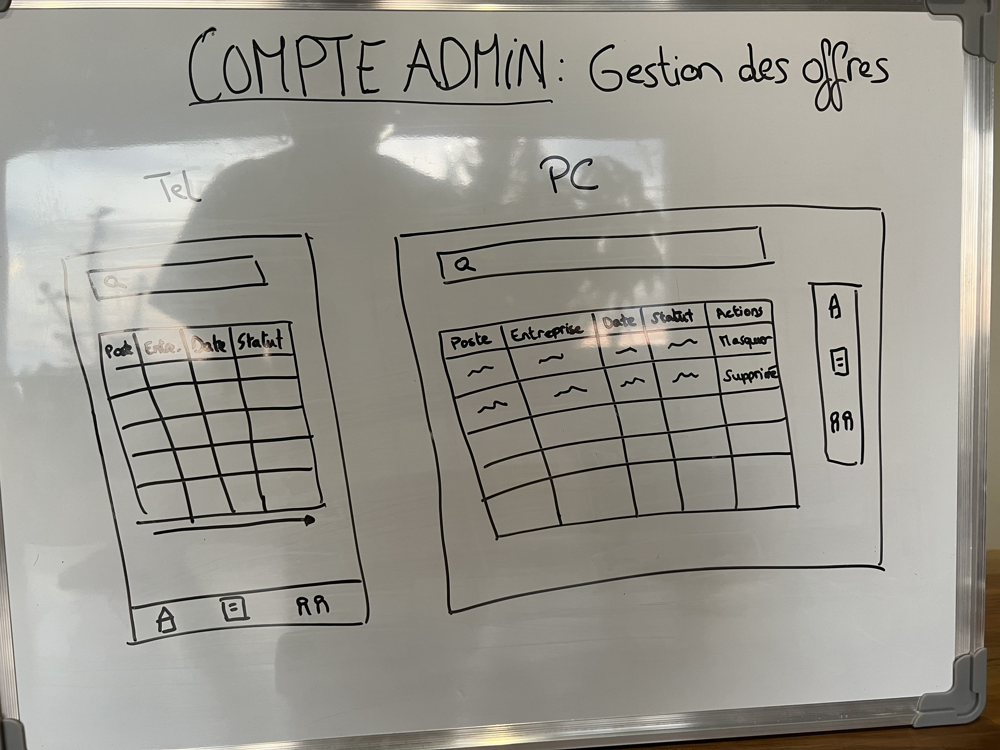
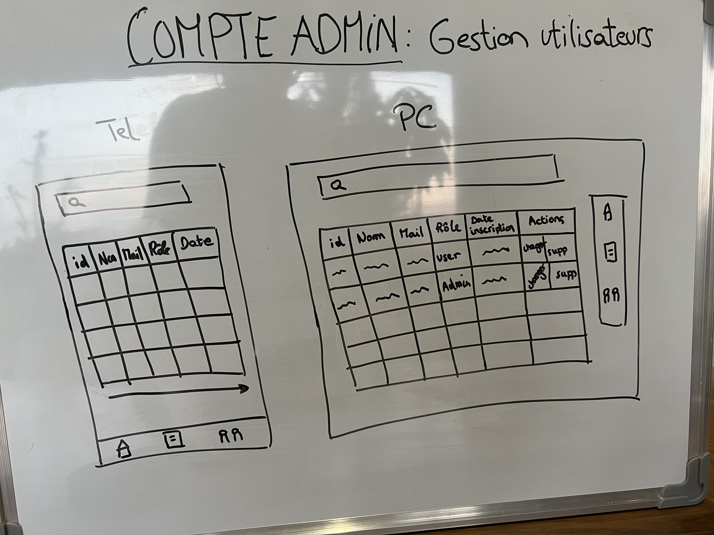

# Nos wireframes

Les wireframes ont été conçus en responsive design, couvrant les versions 
mobile (TEL) et ordinateur (PC) pour chaque écran clé de la plateforme.

## Pages Login et Register

### Descrition 
L'inscription demande les informations minimales nécessaires : nom, prénom, 
mail, mot de passe et confirmation. Le login est volontairement simplifié 
(mail + mot de passe) pour réduire la friction à l'entrée.

---

## Page Dashboard

### Description
Le dashboard est centré sur la recherche et la découverte d'offres. Il 
comprend :
- Une barre de recherche en haut (par nom d'entreprise ou nom de poste)
- Un système de filtres (niveau, langage, type de contrat, localisation)
- Une liste de fiches de poste affichant : nom du poste, entreprise, 
  description, durée, type de contrat, salaire, localisation...
- Sur ordinateur : une navigation latérale (accueil, comparateur, profil)
- Sur mobile : une navigation en bas de page

### La fiche de poste (modale)
Au clic sur une offre, une page fiche de poste s'affiche avec :
- Toutes les informations détaillées de l'offre
- Un bouton favori (étoile) pour sauvegarder l'offre
- Des suggestions d'offres similaires générées par notre feature AI

### Les filtres disponibles
- Niveau : débutant / avancé / confirmé (à voir comment on va déterminer plus en détail le niveau des utilisateurs: peut-être par niveau d'étude)
- Langage : HTML, CSS, JS, C++, et autres
- Type de contrat : stage / alternance / CDI / CDD
- Localisation : autocomplétion

---

## Page Comparateur d'offre

### Description
Le comparateur permet de sélectionner 2 offres favorites et de les comparer 
côte à côte dans un tableau comparatif. 
Les étapes :
1. L'utilisateur ajoute des offres en favoris depuis le dashboard
2. Il accède au comparateur et sélectionne 2 offres parmi ses favoris ou parmis ses suggestions
3. Il appuie sur "Comparer" et un tableau comparatif se déroule

### Justification
80% de nos répondants au questionnaire ont exprimé le besoin de comparer 
des offres côte à côte. C'est notre feature data principale et elle répond 
directement à un besoin validé.

---

## Pages Profil

### Description
La page profil est divisée en deux onglets :
- **Profil** : affiche les informations personnelles (nom, prénom, mail) 
  et la liste des offres favorites
- **Edit** : permet de modifier ses informations personnelles

L'utilisateur doit pouvoir gérer ses favoris et ses informations depuis un 
seul endroit.

---

## Les Paramètres

### Description
Accessible via l'icône paramètre sur la page profil, les paramètres 
proposent :
- **Accessibilité** : lecture de page, filtre couleur...
- **Confidentialité & Sécurité**
- **Mentions légales**
- **Supprimer le compte**
- **Déconnexion**

---

## Côté administrateur

L'interface de connexion (Login/Register) est identique pour les utilisateurs et les administrateurs. La distinction de rôle est gérée côté serveur : à la connexion, le backend détecte le rôle de l'utilisateur et le redirige vers l'interface correspondante (dashboard user ou dashboard admin).

## Dashboard admin

### Description
Le dashboard admin est épuré et centré sur l'essentiel. 
Il affiche :
- Une barre de recherche en haut avec un bouton de déconnexion
- 2 cartes de statistiques : nombre d'offres ingérées et nombre d'utilisateurs
- Une carte "Date dernière ingestion" pour suivre la fraîcheur des données
- Un bouton "Lancer Ingestion" pour déclencher manuellement la collecte d'offres
- Navigation : dashboard / gestion des offres / gestion des utilisateurs

---

## Gestion des offres admin

### Description
Un tableau listant toutes les offres ingérées avec les colonnes :
- Poste
- Entreprise
- Date
- Statut (visible / masquée)
- Actions : Masquer / Supprimer

Sur mobile le tableau est scrollable horizontalement pour conserver 
toutes les colonnes. Sur desktop toutes les colonnes sont visibles 
directement avec les actions clairement affichées sur chaque ligne.

---

## Gestion des utilisateurs admin

### Description

Un tableau listant tous les utilisateurs avec les colonnes :
- ID
- Nom
- Mail
- Rôle (user / admin)
- Date d'inscription
- Actions : Changer le rôle / Supprimer

Cette interface permet à l'admin de promouvoir un utilisateur en admin 
ou de rétrograder un admin en user, et de supprimer des comptes 
problématiques. 

---

