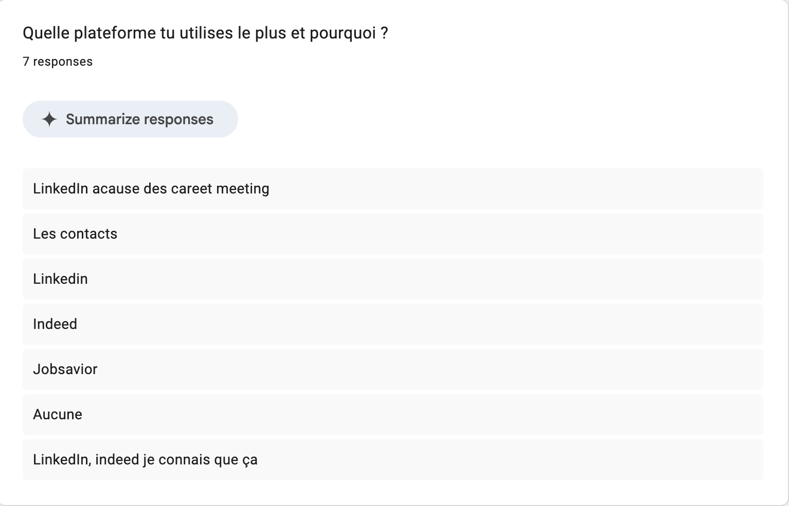
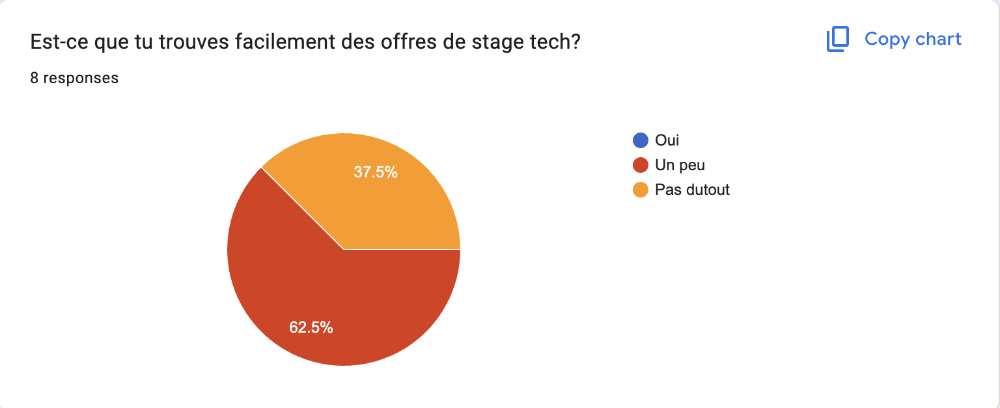
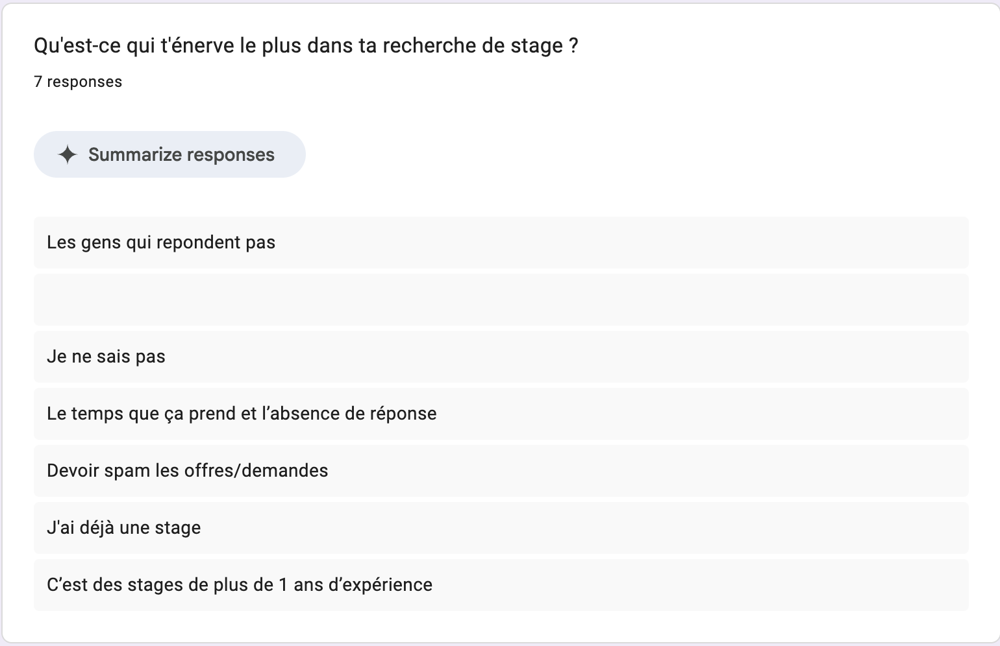
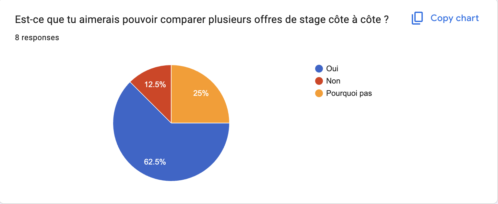
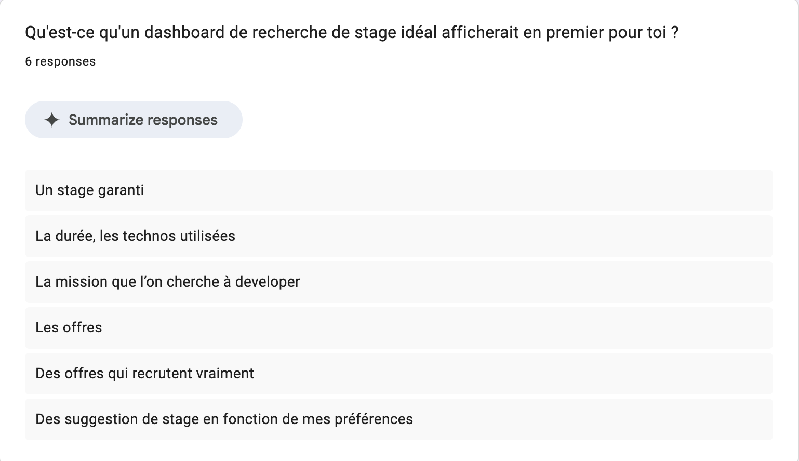

# Étude de marché

## 1. Identification et analyse des acteurs du marché

| Critère | LinkedIn | Indeed | Welcome to the Jungle | WeLoveDevs | Talent.io | JobTeaser |
|---|---|---|---|---|---|---|
| Cible principale | tous profils | tous profils | tous profils | développeurs | développeurs | étudiants/jeunes diplômés|
| Spécialisé tech | ❌ | ❌ | ❌ | ✅ | ✅ | ⚠️ |
| Filtres avancés | ⚠️ | ⚠️ | ⚠️ | ✅ | ✅ | ⚠️ |
| Transparence salariale | ⚠️ | ⚠️ | ⚠️ | ✅ | ✅ | ❌ |
| Fiches entreprises détaillées | ⚠️ | ❌ | ✅ | ✅ | ⚠️ | ⚠️ |
| Tests techniques | ❌ | ❌ | ❌ | ✅ | ✅ | ❌ |
| Dashboard / Analytics | ❌ | ❌ | ❌ | ❌ | ❌ | ❌ |
| Adapté étudiants/juniors | ⚠️ | ⚠️ | ⚠️ | ⚠️ | ⚠️ | ✅ |
| Disponible en France | ✅ | ✅ | ✅ | ✅ | ✅ | ✅ |
| Points forts | Réseau pro mondial | Volume d'offres énorme | Culture entreprise mise en avant | Pensé par des devs | Matching direct recruteur | Partenariats écoles |
| Points faibles | Trop généraliste | Expérience utilisateur basique | Pas spécialisé tech | Peu d'offres stages/alternances | Base candidats limitée | Peu d'offres tech avancées |

- Sur les ⚠️ : ils indiquent une fonctionnalité présente mais incomplète ou peu poussée. Par exemple LinkedIn affiche parfois des salaires mais c'est rare et non systématique, ou Indeed propose des filtres mais trop basiques pour un profil dev.
- Sur les ❌ : la fonctionnalité est absente ou inexistante sur la plateforme.
- Sur les ✅ : la fonctionnalité est bien présente et constitue un point fort réel de la plateforme.

### Synthèse de l'analyse concurrentielle

Le marché de l'emploi tech en France est dominé par des plateformes généralistes (LinkedIn, Indeed) qui offrent un volume d'offres important mais manquent de profondeur pour les profils développeurs. Les plateformes spécialisées (WeLoveDevs, Talent.io) comblent en partie ce manque avec des filtres avancés et une transparence salariale, mais restent peu adaptées aux étudiants et stagiaires. JobTeaser cible bien les juniors mais n'est pas orienté tech.

Trois problématiques ressortent clairement :

- Aucune plateforme n'agrège plusieurs sources : chaque candidat doit multiplier les recherches sur différents sites.
- Aucune ne propose de dashboard ou d'analytics : il n'existe pas d'outil permettant de visualiser les tendances du marché, la distribution des salaires ou de comparer des offres côte à côte.
- L'expérience junior/étudiant est négligée sur les plateformes tech les plus complètes.

## 2. Les tendances du marché

### Un marché en reprise

Le marché tech français compte 450 000 emplois directs avec une croissance nette de +4,6% sur le premier semestre 2025. Cependant, le nombre de candidatures par offre est passé de 32 en 2023 à 56 en 2025, ce qui signifie que la concurrence entre candidats est beaucoup plus forte. Une reprise progressive des recrutements est attendue en 2026, portée par la relance des investissements technologiques notamment en IA, cybersécurité et cloud.

Source : Stackjobs, Le Ticket, LemondeInformatique

### Les profils les plus recherchés

JavaScript/TypeScript, Python, Java et Go dominent les offres en 2026, et la maîtrise d'un framework frontend combinée à un langage backend est la combinaison la plus recherchée. Les postes les plus recherchés restent concentrés autour de la cybersécurité, du cloud et de la data, où la pénurie persiste. 

Source : Mercato de l'Emploi, LeMondeInformatique

### Le marché est plus difficile pour les juniors

Les profils juniors et non spécialisés doivent affronter des processus de sélection plus lourds, une concurrence internationale renforcée, et une lecture plus stricte des CV sans preuve concrète. Plus de la moitié des devs juniors trouvent le marché compliqué, contre 34% chez les seniors.

Source : Free-Work, Les Joies du Code

### La transparence salariale

En 2026, l'affichage des salaires ne relève plus du bon vouloir de l'employeur.  Un développeur fullstack démarre autour de 42k€ à Paris et 36k€ en région, et peut atteindre 63k€ après dix ans d'expérience. Les candidats veulent ces données accessibles dès la recherche d'offres.

Source : Free-Work, Learnup

### L'IA transforme le recrutement

L'IA a pénétré durablement les RH : matching, scoring, tri de CV, préqualification automatisée sont désormais courants.

Source : Free-Work 

## 3. Identification des besoins

Pour identifier les besoins que l'ont vie nous en tant qu'étudiants, on a décidé de faire un questionnaire dédié à notre classe qui va nous permettre de visualiser les problèmes que l'on rencontre dans la recherche d'offre tech, et pour cela on a décidé de le mettre à notre échelle en mettant en situation ce que l'on vit acutellement : notre recherche de stage.

### Besoins identifiés via notre questionnaire

- Besoin 1 — Centralisation des offres
Les candidats doivent aujourd'hui jongler entre LinkedIn, WeLoveDevs, JobTeaser 
et les contacts personnels sans outil centralisé adapté aux profils tech juniors. 
Notre questionnaire le confirme : 60% de nos camarades ne passent pas par des 
plateformes classiques pour chercher leur stage, faute d'alternative adaptée.

- Besoin 2 — Filtres adaptés aux profils juniors
Les filtres existants ne permettent pas de chercher par stack technique, durée 
de stage ou niveau junior, l'expérience est pensée pour des profils confirmés. 
Notre questionnaire le confirme : 80% de nos camarades trouvent les offres 
seulement "un peu" facilement, personne ne répond "oui" clairement, et la 
frustration principale est que les offres demandent souvent plus d'un an 
d'expérience. 100% voudraient filtrer par stack technique.

- Besoin 3 — Qualité et précision des informations
Les offres manquent souvent d'informations précises : salaires absents, 
descriptions vagues, niveau requis mal défini. Les étudiants ne savent pas 
ce qu'ils peuvent négocier et postulent en masse pour compenser. Notre 
questionnaire le confirme : la frustration majoritaire est de devoir "spammer" 
les offres faute d'informations suffisantes, et la fonctionnalité la plus 
demandée est la recherche par mot-clé.

- Besoin 4 — Comparaison d'offres
Aucune plateforme ne permet de comparer deux offres côte à côte avec les mêmes 
critères structurés. Les juniors ne disposent d'aucun outil pour prioriser et 
choisir efficacement. Notre questionnaire le confirme : 80% de nos camarades 
aimeraient comparer plusieurs offres côte à côte, un besoin quasi unanime.

- Besoin 5 — Recommandation personnalisée
Les juniors ne savent pas quelles technos sont les plus demandées, quels secteurs 
recrutent, ou comment se positionner sur le marché. Il manque un dashboard qui 
donne une vision claire et personnalisée. Notre questionnaire le confirme : la 
majorité souhaite voir directement les technos, la durée et des suggestions 
adaptées à leur profil, ce qui valide la pertinence d'une feature AI de 
recommandation.

## 4. Positionnement

Notre plateforme s'adresse aux étudiants et profils juniors en école d'ingénieurs tech qui cherchent un stage ou une alternance ou même une offre de travail et qui sont frustrés par des plateformes généralistes inadaptées à leur niveau et à leurs besoins techniques.

Là où LinkedIn est trop généraliste, Welcome to the Jungle trop orienté culture d'entreprise, et JobTeaser trop limité en fonctionnalités tech, notre agrégateur se positionne comme le seul outil pensé spécifiquement pour les étudiants tech qui veulent chercher, comparer et comprendre le marché des stages en un seul endroit, en s'appuyant sur les données réelles de WeLoveDevs enrichies par nos propres features.

### Valeur ajouté

Ce que les autres ne font pas et que nous faisons :

| Fonctionnalité | Concurrents | Notre plateforme |
|---|---|---|
|Filtres par stack technique | ⚠️ Partiel |✅ Natif|
|Comparaison d'offres côte à côte | ❌ | ✅|
|Dashboard d'analyse du marché | ❌ | ✅ |
|Recommandation personnalisé| ❌ | ✅ |
|Adapté profils juniors/étudiants| ⚠️ Partiel | ✅ |

## 5. Conclusion

Le marché de l'emploi tech en France est en pleine mutation. Si les opportunités existent, elles restent difficiles d'accès pour les étudiants et profils juniors qui se retrouvent face à des plateformes pensées pour des profils confirmés, sans outils adaptés à leur réalité.

Notre questionnaire le confirme : les étudiants cherchent sur plusieurs plateformes en même temps, ne trouvent pas facilement des offres adaptées à leur niveau, et manquent d'outils pour comparer et décider efficacement.

Aucun acteur du marché actuel ne répond simultanément à ces trois besoins fondamentaux : centraliser les offres tech, les filtrer intelligemment, et aider à la décision. C'est exactement le vide que notre plateforme vient combler.

Notre valeur ajoutée ne repose pas sur le volume d'offres, mais sur la qualité de l'expérience : trouver le bon stage, au bon moment, avec les bonnes informations, sans avoir à chercher partout.